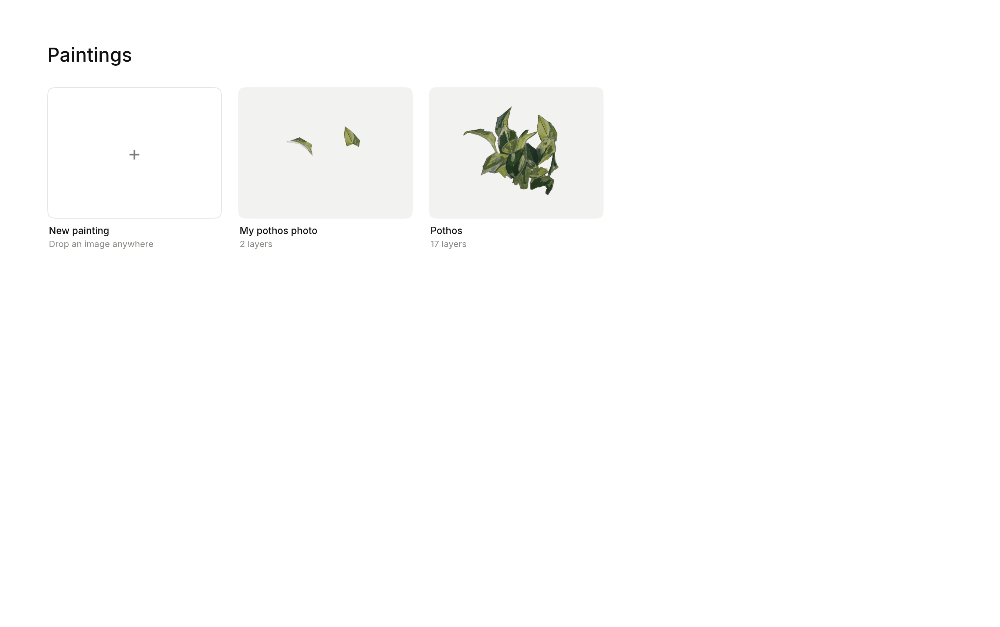
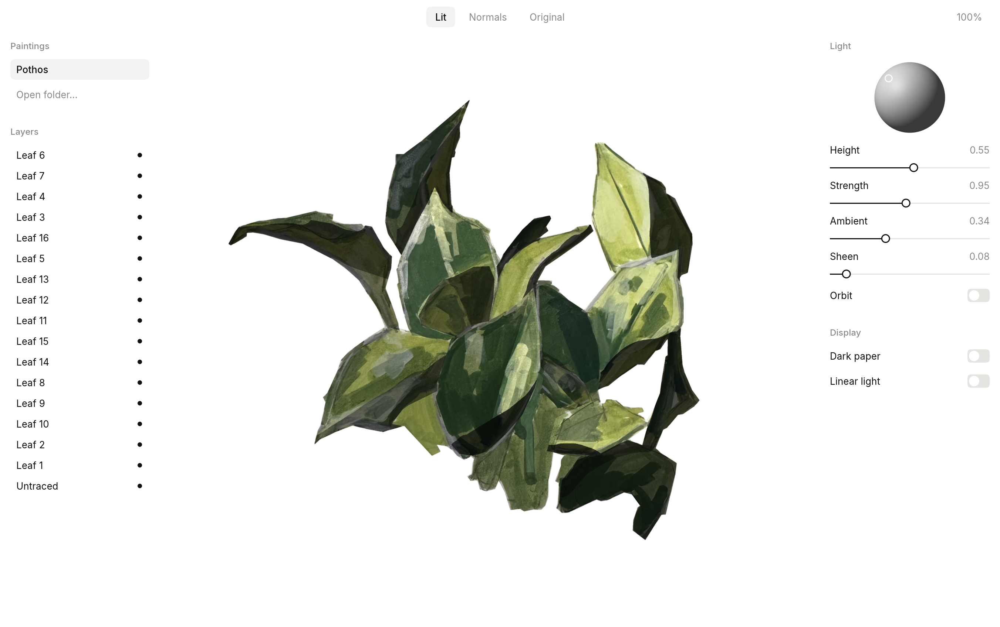

# light and shade

A native studio for cutting paintings into layers, painting normals, and lighting them.
Rust, `wgpu` (Metal, Vulkan, DX12) and `egui`.

`projects/<name>/` holds one painting. `reference/pothos/` holds the browser tools' source and
Python pipeline this was ported from.





## Run

```sh
cargo run -p light-and-shade        # from the repo
./scripts/bundle-mac.sh             # builds target/Light and Shade.app
```

The Rust version is pinned in `rust-toolchain.toml`. Paintings live in `LAS_PROJECTS`, or this repo's
`projects/` when run from a checkout, or `Documents/Light and Shade` otherwise. Only the pothos is
tracked by git.

## Using it

Drop a PNG, JPEG or WebP anywhere on the home page, or click New painting. Each card's … menu renames a painting, exports it, or moves it to the Trash. Exports are
`.lightshade` files, a zip of the painting's folder; drop one on the home page to import it. Covers show the painting and its normals, split on the diagonal.

Two fingers on a trackpad pan, and a pinch or a mouse wheel zooms. Both work on every canvas.

**Cutting:** click around a piece or drag to draw it. Click the first point or press Return to close
it. To pan by dragging, switch to the Move tool (M, and C to go back) or hold Space. The Hole tool (H) traces an area to punch out of a piece: the selected one, or else the
frontmost piece the hole starts on. Select a piece to drag its hole points or fill its holes. Select a piece in the list to drag its
points or delete it. Backspace removes the last point, Esc cancels, and Cmd+Z undoes. Later pieces sit
in front. Done cuts them out into layers.

**Painting normals:** click Paint in the studio, pick a piece in the list, and pick a facing direction
on the sphere. Set the sphere to 32 or 16 shades to limit it to that many evenly spread directions, as
Voronoi cells. Brush (B) paints it, Shape (L) fills an area you outline with dots or a quick drag, and stays selected so you can pick its direction,, and Erase (E) goes back to
facing you. `[` and `]` change the size, Option-click picks up a direction from the piece, and Cmd+Z
undoes, with Shift to redo. Strokes stay editable and survive re-cutting. The Normals view shows normals over the lit
painting, with a slider pinned above the panel for how strongly. Moving it switches to that view.

**Lighting:** drag the painting or the ball to move the light. To pan by dragging, turn on Move (M) or
hold Space. Click a
layer to hide it. Double-click,
press F or click the zoom level to fit. Keys 1, 2 and 3 switch views, and O orbits the light.

## Layout

| Crate | Holds |
|---|---|
| `crates/core` | Project format and view maths. No GPU or UI. |
| `crates/render` | The `wgpu` renderer and its WGSL shader. |
| `crates/app` | The `egui` app: `home`, `cut` and `light` screens under `studio`. Every control comes from `design.rs`; OS-specific code stays in `platform.rs`. |

## Capturing the app

These run the real app and need no OS permissions. `LAS_SHOT` saves the window once it settles, then
exits. Coordinates are window points.

```sh
LAS_SHOT=shots/a.png LAS_OPEN=pothos LAS_MODE=normals LAS_ZOOM=2 cargo run -p light-and-shade
LAS_SHOT=shots/b.png LAS_DROP=photo.png LAS_PROJECTS=shots/lib cargo run -p light-and-shade
LAS_SHOT=shots/c.png LAS_OPEN=photo LAS_CLICKS="300,200;400,200;400,300" LAS_DRAG="500,200;600,300" \
  cargo run -p light-and-shade
```
